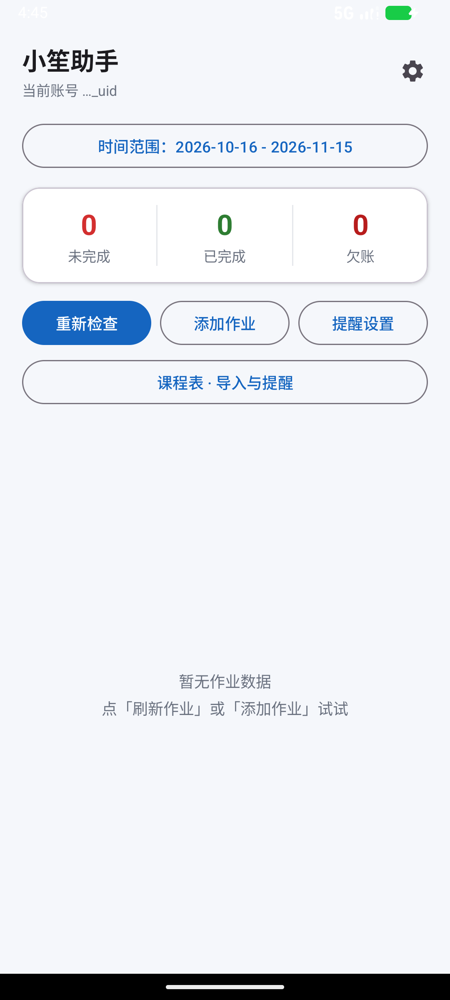
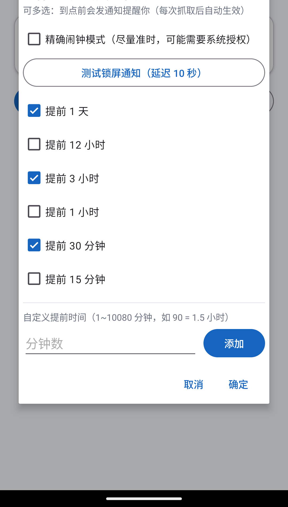
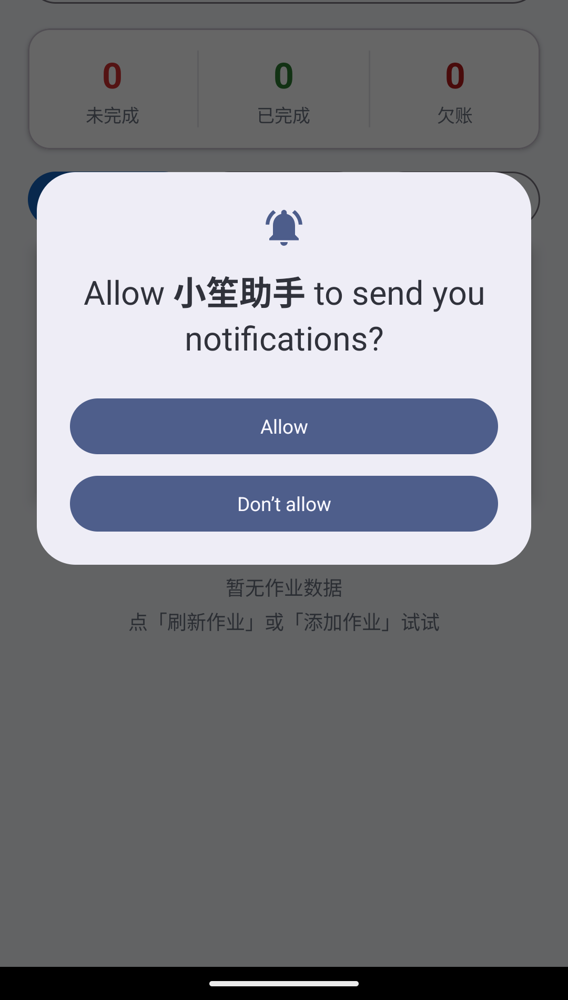
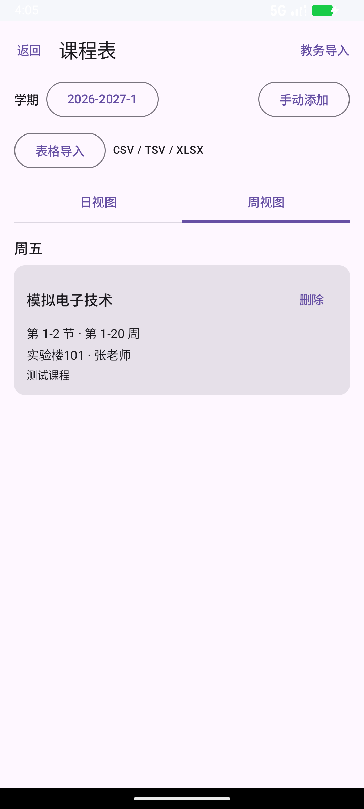
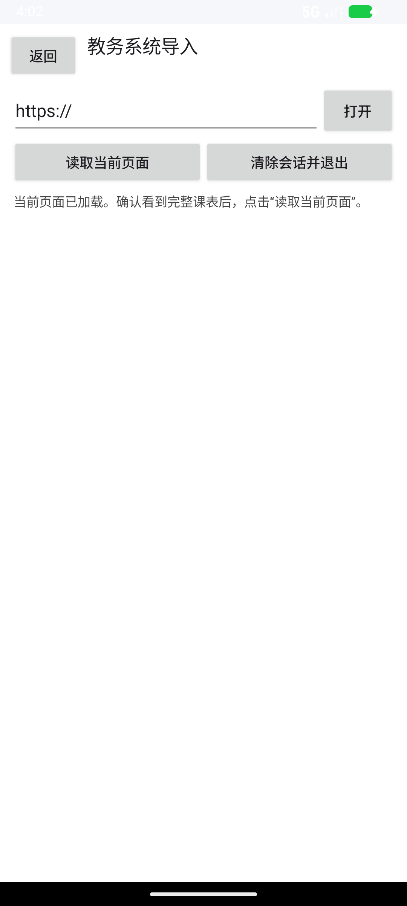

# 小笙助手（XiaoShengAssistant）

**当前版本：v0.2.6（体验版）**

小笙助手是一款**只读的学习通作业与课程提醒工具**：它把学习通课程、作业状态和
截止时间整理成可筛选的本地列表，并提供课程表导入和锁屏提醒。应用不会自动答题、
不会自动提交作业，也不会把 Cookie、密码或业务数据上传到第三方服务器。

> 这是持续迭代中的体验版本。自动化构建和单元测试已通过，但仍有少量真机使用体验需要
> 后续验证和改进。发布包未签名；安装前请允许安装来自此来源的应用。仓库不包含真实账号、
> Cookie、浏览器会话或设备专属配置。

## 功能速览

| 模块 | 当前能力 |
| --- | --- |
| 学习通作业 | 读取课程与作业列表；必要时沿官方详情入口逐条核对截止时间 |
| 稳定缓存 | 已获取的可靠作业会本地保留；网络失败、验证码或解析为空不会抹掉旧数据 |
| 空课程判定 | 只有页面明确显示“暂无作业”才会删除该课程旧作业缓存 |
| 时间筛选 | 全部、今天、未来 7 天、本周、本月、自定义日期范围；未知时间不混入日期范围 |
| 未知截止时间 | 按课程汇总，一天最多提示一次；已完成且时间未知的作业不显示 |
| 手动作业 | 可添加没有学习通作业的课程，截止时间支持本地完成、隐藏和提醒 |
| 课程选择 | 最近使用/添加、拼音首字母两种排序；数字和特殊字符归入 `#`，提供 A-Z 快速索引 |
| 列表交互 | 默认单列；课程分组模式可收起课程，并可把同一课程内部作业设为双列 |
| 课程表 | 日视图/周视图、手动添加、CSV/TSV/XLSX/HTML 预览导入、通用教务 WebView 导入 |
| 课程提醒 | 课前 30 分钟、前一天 20:00 准备提醒；通知默认保持到用户点击“知道了” |
| 作业提醒 | 多个提前节点、独立滚轮/手动输入、自定义节点长按删除、可选精确闹钟模式 |
| 会话 | WebView 登录/验证；验证完成只同步 Cookie，用户手动点击“重新检查” |

## 界面预览

截图来自本地模拟器和脱敏演示数据，只展示界面状态，不包含真实账号、密码、Cookie
或完整学习通会话地址。

### 作业主列表

课程分组、欠账、未完成、已完成和未知截止时间提示相互分开；普通列表默认单列。



### 提醒设置

提醒节点可以多选；自定义节点在独立小弹窗中使用滚轮，也可以点击数字输入分钟数。



### 权限引导

通知权限、锁屏显示、声音和精确闹钟都由 Android 系统控制，应用只能逐项引导用户打开，
不能绕过手机厂商的电池策略。



### 课程表与导入

课程表支持日/周视图、学期切换、手动添加、CSV/TSV/XLSX 表格导入，以及在应用内打开
学校教务系统、登录后读取当前课表并预览确认。导入前只显示预览，确认后才替换同一学期、
同一来源的课程。





## 工作原理

```text
WebView 登录学习通
    -> 本地保存当前账号 Cookie（按 uid 隔离）
    -> 课程列表接口 / 网页入口
    -> 作业列表解析标题、状态、官方详情地址
    -> 用户点击“重新检查”时逐条打开详情页读取可靠截止时间
    -> 本地缓存合并、日期筛选、分组展示
    -> AlarmManager / WorkManager 到点发锁屏通知
```

列表接口里的时间只作为候选值。详情页出现“作答时间：开始至截止”时，截止时间以详情
页为准；没有充分证据时保留“未知”，不拿课程结束时间或发布时间冒充作业截止时间。

### 会话与隐私

- 登录、验证码和学习通网页由用户本人在官方 WebView 中完成。
- 应用只保存当前账号所需的 Cookie；验证页完成后同步 Cookie，不会自动连续深度抓取。
- 调试日志仅在 Debug 构建写入应用私有目录，代码不会写入密码、Cookie 或完整会话令牌。
- 退出登录会取消作业和课程提醒，但保留该 uid 的本地作业、课程和隐藏设置，方便以后重新登录。

### 通知边界

应用使用高优先级通知频道、公开锁屏可见性、声音和振动配置，并在系统重启、时区变化、
日期变化和应用更新后重排任务。Android 或厂商仍可能因为通知总开关、频道静音、勿扰模式、
电池优化、后台限制或用户强制停止应用而延迟/阻止通知；这些设置必须在目标手机上验收。

## 项目结构

```text
app/src/main/java/com/zhizhou/xxtassistant/
├── LoginActivity.kt                 # 学习通 WebView 登录与 Cookie 捕获
├── MainActivity.kt                  # 作业列表、筛选、分组、设置和手动作业
├── HomeworkAdapter.kt               # 列表排序、折叠、批量操作
├── HomeworkDetailActivity.kt        # 官方作业详情 WebView（只读打开）
├── CourseTableActivity.kt            # 课程表日/周视图与表格导入
├── CourseWebImportActivity.kt        # 通用教务系统 WebView 导入
├── data/
│   ├── XueXiTongApi.kt              # 课程、作业、详情链路
│   ├── DeadlineParser.kt             # 截止时间解析
│   ├── HomeworkCache*.kt             # 缓存合并与检查策略
│   ├── CourseSchedule*.kt            # 课程表模型和本地存储
│   └── CourseTableParser.kt          # CSV/TSV/HTML/XLSX 解析
└── remind/
    ├── ReminderScheduler.kt          # 作业提醒调度
    ├── CourseReminderScheduler.kt     # 课程提醒调度
    ├── *Receiver.kt                   # 闹钟广播接收与通知
    └── ReminderWorker.kt              # WorkManager 兜底
```

`audit/小笙助手-开发调试学习教程.md` 是面向新手的逐步说明；`audit/official-research.md`
记录了学习通页面证据、Android 通知边界和本地复测结论。

## 本地构建与验证

使用 Android Studio 打开项目，安装 Android SDK 34 和 JDK 17 后即可同步并构建。也可以在
项目根目录通过 Gradle Wrapper 执行：

```powershell
.\gradlew.bat testDebugUnitTest lintDebug assembleDebug
```

本轮本地回归已执行并通过：

- `testDebugUnitTest`：169 项 JVM 单元测试，0 failures，0 errors
- `lintDebug`：0 errors，1 warning（Compose primitive state 装箱性能提示）
- `assembleDebug` 与 `assembleRelease`：均构建成功
- 本次没有连接 Android 设备，未能复测页面交互、息屏锁屏声音或后台清理后的提醒表现

Release APK 文件名为 `XiaoShengAssistant-v0.2.6-unsigned.apk`，发布后可从
[GitHub Releases](https://github.com/ZivSpectra/XiaoShengAssistant/releases/latest) 获取。
该 APK 未签名，不能覆盖安装在已安装的正式签名版本上；正式签名证书不会上传到仓库。

不同品牌的锁屏声音、后台保活、精确闹钟权限和电池策略仍需在目标设备上实际验收。没有
精确闹钟权限时，系统可能延迟提醒；授予该权限后应用才会请求精确闹钟。

## 第三方项目与许可证

课程表交互思路参考了 [Potato-DiGua/Timetable](https://github.com/Potato-DiGua/Timetable)。
“自动关闭开屏/摇一摇广告”方向参考了 [GuoXiCheng/SKIP](https://github.com/GuoXiCheng/SKIP)，
画图模块方向参考了 [ZivSpectra/Plotforge](https://github.com/ZivSpectra/Plotforge)。
当前版本没有复制这些项目的代码、品牌或素材。许可证核对、使用边界和后续引入代码的条件
详见 [THIRD_PARTY_NOTICES.md](THIRD_PARTY_NOTICES.md)。

`D:\小笙\表情包成品\` 暂不随公开仓库提交。公开分发前仍需确认生成服务条款、输入素材权利
和表情包的可再分发范围。

## 免责声明

学习通接口和页面属于第三方服务，可能随时改版或要求验证码。小笙助手只用于个人学习管理，
不用于自动答题、刷课、绕过验证码或提交作业。请遵守学校和平台规则；通知能否在锁屏、息屏
和厂商后台限制下正常送达，需在自己的设备上验证。欢迎通过 GitHub Issues 提交体验问题。
